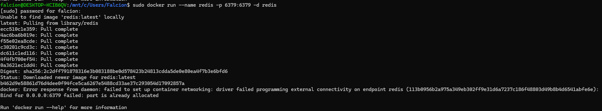
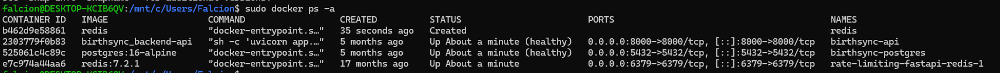
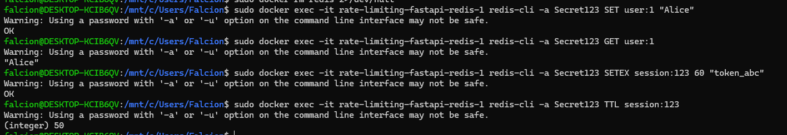
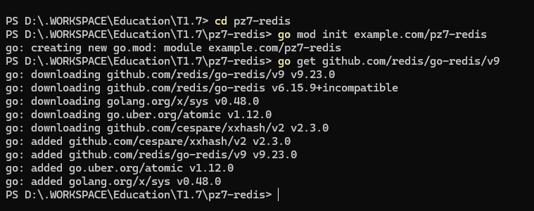
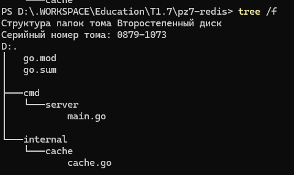
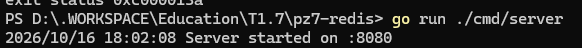
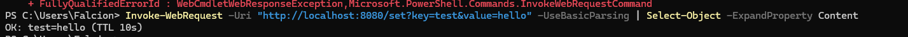
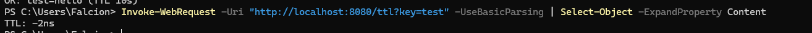
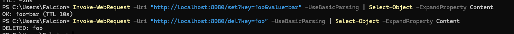

В репозитории хранится PDF версия отчёта, сделанная в редакторе Obsidian.

Исходный код находится в папке `/src/`.

**Цель работы:**
- Освоить базовые операции работы с Redis из Go-приложения.
- Научиться использовать команды `SET`, `GET`, задавать время жизни ключей (`TTL`).
- Реализовать кэширование данных для ускорения работы API.
- Понять, в каких случаях кэш помогает снизить нагрузку на базу данных.
## Введение

**Redis (Remote Dictionary Server)** — высокопроизводительное in-memory key-value хранилище. Данные хранятся в оперативной памяти, доступ — за миллисекунды. Поддерживает строки, списки, множества, хэши, упорядоченные множества и др. Имеет встроенный механизм **TTL** (time-to-live), при истечении которого ключ удаляется автоматически.

**Основные команды:**
- `SET key value` — сохранить значение;
- `GET key` — получить значение;
- `SETEX key ttl value` — сохранить значение с TTL (в секундах);
- `EXPIRE key ttl` — задать TTL существующему ключу;
- `TTL key` — узнать, сколько секунд осталось;
- `DEL key` — удалить ключ.

Redis применяется для кэширования результатов запросов к БД, хранения сессий, очередей, счётчиков и рейтингов.
## Шаг 1. Установка и запуск Redis

Запустим Redis локально через Docker:

```powershell
docker run --name redis -p 6379:6379 -d redis
```

Проверим, что контейнер запущен:

```powershell
docker ps
```



Такая ошибка вылезает, т.к. в нашем случае уже был запущенный Redis докер, игнорируем пункты выше.



Проверим работу Redis напрямую через `redis-cli` внутри контейнера:

```powershell
sudo docker exec -it redis redis-cli SET user:1 "Alice"
sudo docker exec -it redis redis-cli GET user:1
sudo docker exec -it redis redis-cli SETEX session:123 60 "token_abc"
sudo docker exec -it redis redis-cli TTL session:123
```


## Шаг 2. Инициализация Go-проекта

Откроем терминал в папке, где будем создавать проект:

```powershell
mkdir pz7-redis
cd pz7-redis
go mod init example.com/pz7-redis
go get github.com/redis/go-redis/v9
```



Структура проекта:

```powershell
pz7-redis/
├── cmd/
│   └── server/
│       └── main.go
├── internal/
│   └── cache/
│       └── cache.go
└── go.mod

# Команды
mkdir cmd/server/
mkdir internal/cache
New-Item cmd/server/main.go
New-Item internal/cache/cache.go
```


## Шаг 3. Реализация кэша — `internal/cache/cache.go`

Создадим файл `internal/cache/cache.go`:

```go
package cache

import (
	"context"
	"time"

	"github.com/redis/go-redis/v9"
)

type Cache struct {
	rdb *redis.Client
}

func New(addr string) *Cache {
	rdb := redis.NewClient(&redis.Options{
		Addr:     addr,
		Password: "",
		DB:       0,
	})
	return &Cache{rdb: rdb}
}

func (c *Cache) Set(key string, value string, ttl time.Duration) error {
	return c.rdb.Set(context.Background(), key, value, ttl).Err()
}

func (c *Cache) Get(key string) (string, error) {
	return c.rdb.Get(context.Background(), key).Result()
}

func (c *Cache) TTL(key string) (time.Duration, error) {
	return c.rdb.TTL(context.Background(), key).Result()
}

func (c *Cache) Del(key string) error {
	return c.rdb.Del(context.Background(), key).Err()
}
```
## Шаг 4. HTTP-сервер — `cmd/server/main.go`

Создадим файл `cmd/server/main.go`:

```go
package main

import (
	"fmt"
	"log"
	"net/http"
	"time"

	"example.com/pz7-redis/internal/cache"
)

func main() {
	c := cache.New("localhost:6379")

	mux := http.NewServeMux()

	// /set?key=...&value=...
	mux.HandleFunc("/set", func(w http.ResponseWriter, r *http.Request) {
		key := r.URL.Query().Get("key")
		value := r.URL.Query().Get("value")
		if key == "" || value == "" {
			http.Error(w, "key and value required", http.StatusBadRequest)
			return
		}
		err := c.Set(key, value, 10*time.Second) // TTL = 10 сек
		if err != nil {
			http.Error(w, err.Error(), http.StatusInternalServerError)
			return
		}
		fmt.Fprintf(w, "OK: %s=%s (TTL 10s)", key, value)
	})

	// /get?key=...
	mux.HandleFunc("/get", func(w http.ResponseWriter, r *http.Request) {
		key := r.URL.Query().Get("key")
		val, err := c.Get(key)
		if err != nil {
			http.Error(w, err.Error(), http.StatusNotFound)
			return
		}
		fmt.Fprintf(w, "VALUE: %s", val)
	})

	// /ttl?key=...
	mux.HandleFunc("/ttl", func(w http.ResponseWriter, r *http.Request) {
		key := r.URL.Query().Get("key")
		ttl, err := c.TTL(key)
		if err != nil {
			http.Error(w, err.Error(), http.StatusInternalServerError)
			return
		}
		fmt.Fprintf(w, "TTL: %s", ttl)
	})

	// /del?key=...
	mux.HandleFunc("/del", func(w http.ResponseWriter, r *http.Request) {
		key := r.URL.Query().Get("key")
		if err := c.Del(key); err != nil {
			http.Error(w, err.Error(), http.StatusInternalServerError)
			return
		}
		fmt.Fprintf(w, "DELETED: %s", key)
	})

	log.Println("Server started on :8080")
	log.Fatal(http.ListenAndServe(":8080", mux))
}
```
## Шаг 5. Запуск сервера

В корне проекта:

```powershell
go run ./cmd/server
```

**Из-за особенностей авторизации: мы указываем пароль для сервера:**

```go
c := cache.New("localhost:6379", "Secret123")
```


## Шаг 6. Проверка API через PowerShell

Все запросы выполняются в отдельном окне PowerShell.
### 6.1. Сохранение значения с TTL = 10 сек

```powershell
Invoke-WebRequest -Uri "http://localhost:8080/set?key=test&value=hello" -UseBasicParsing | Select-Object -ExpandProperty Content
```

[[СКРИНШОТ: ответ `OK: test=hello (TTL 10s)`]]
### 6.2. Получение значения

```powershell
Invoke-WebRequest -Uri "http://localhost:8080/get?key=test" -UseBasicParsing | Select-Object -ExpandProperty Content
```


### 6.3. Проверка TTL

Выполним сразу после `set`:

```powershell
Invoke-WebRequest -Uri "http://localhost:8080/ttl?key=test" -UseBasicParsing | Select-Object -ExpandProperty Content
```

[[СКРИНШОТ: ответ `TTL: 9s` (или похожее значение < 10s)]]
### 6.4. Проверка истечения TTL

Подождём 11 секунд и повторим `get`:

```powershell
Start-Sleep -Seconds 11
Invoke-WebRequest -Uri "http://localhost:8080/get?key=test" -UseBasicParsing
```


### 6.5. Удаление ключа вручную (опционально)

```powershell
Invoke-WebRequest -Uri "http://localhost:8080/set?key=foo&value=bar" -UseBasicParsing | Select-Object -ExpandProperty Content
Invoke-WebRequest -Uri "http://localhost:8080/del?key=foo" -UseBasicParsing | Select-Object -ExpandProperty Content
```


## Шаг 7. Публикация в GitHub

```powershell
# https://github.com/angelomira/ToIP/tree/practice/07
git checkout practice/07
git add .
git commit -m "Practice 7"
git push --up-stream practice/07
```
## Ответы на контрольные вопросы

1. **Чем Redis отличается от реляционной БД?**
   
Redis хранит данные в оперативной памяти, использует модель «ключ–значение» без таблиц и SQL-запросов, работает с командами (`SET`, `GET`, `EXPIRE`). Реляционные БД (PostgreSQL, MySQL) хранят данные на диске, используют таблицы, схему и SQL, обеспечивают ACID-транзакции. Redis быстрее, но не предназначен для долговременного хранения критичных данных (хотя поддерживает персистентность).

2. **Какие типы данных поддерживает Redis кроме строк?**
   
Списки (list), множества (set), упорядоченные множества (sorted set / zset), хэши (hash), битовые строки (bitmap), HyperLogLog, геопространственные индексы (GEO), потоки (stream).

3. **Зачем нужен TTL? Приведите примеры.**
   
TTL задаёт время жизни ключа, после которого Redis автоматически его удаляет. Это позволяет:

- хранить кэш ограниченное время и не держать устаревшие данные (например, список популярных товаров обновляется раз в 5 минут);
- автоматически удалять сессии пользователей через 30 минут неактивности;
- реализовывать лимиты (rate limiting) — например, не более N запросов в минуту;
- освобождать память от неактуальных данных без ручной очистки.

4. **Как Redis помогает снизить нагрузку на PostgreSQL?**

Redis работает как кэш перед БД: при первом запросе приложение берёт данные из PostgreSQL и сохраняет результат в Redis с TTL. Последующие запросы обслуживаются из Redis без обращения к БД. Схема:
`Клиент → Backend → Redis (есть кэш?) → если нет → PostgreSQL`.
Это снижает число тяжёлых SQL-запросов и ускоряет API.

5. **Что произойдёт, если ключ в Redis «протух» по TTL, а приложение попытается его прочитать?**

Команда `GET` вернёт `nil` (в go-redis это `redis.Nil`), значение отсутствует. В нашем примере HTTP-обработчик `/get` отдаёт ошибку 404. Обычно приложение в этом случае идёт в основную БД, получает актуальные данные и снова кладёт их в кэш.
## Вывод

В ходе работы:

- установлен и запущен Redis в Docker;
- создан Go-проект с библиотекой `go-redis/v9`;
- реализован простой кэш с методами `Set`, `Get`, `TTL`, `Del`;
- поднят HTTP-сервер с эндпоинтами `/set`, `/get`, `/ttl`, `/del`;
- проверены запросы через PowerShell (`Invoke-WebRequest`);
- экспериментально подтверждено, что по истечении TTL ключ автоматически удаляется из Redis.

Redis позволяет эффективно кэшировать данные, снижая нагрузку на основную БД и ускоряя отклик API. TTL делает кэш самоочищающимся и защищает приложение от работы с устаревшими данными.