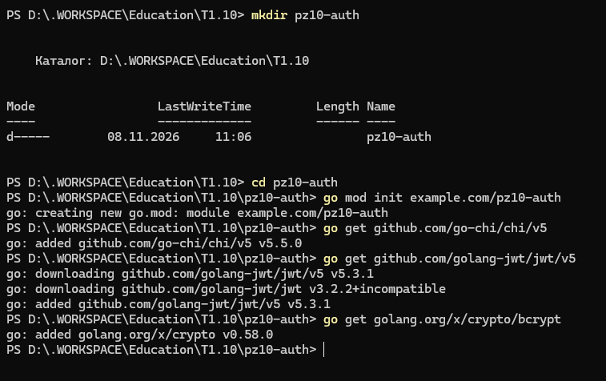
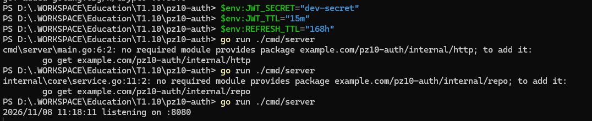
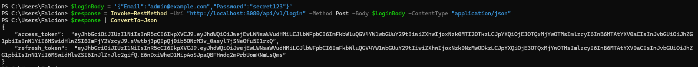
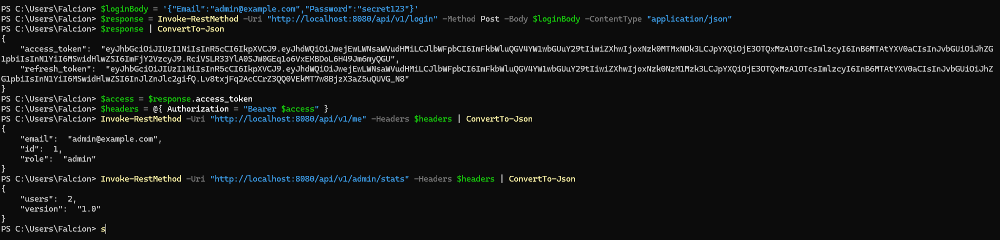
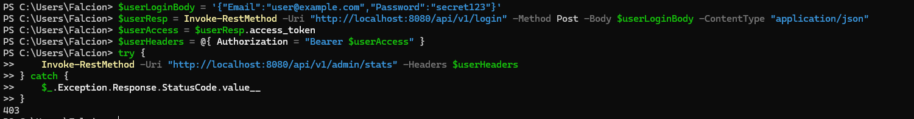
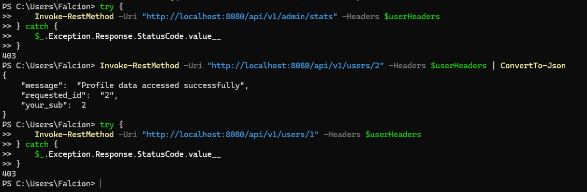
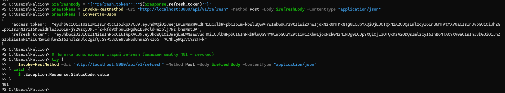
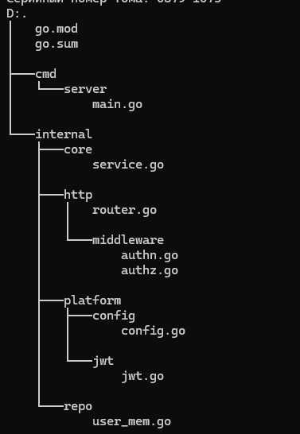

Исходный код проекта прилагается в корневой директории. Ниже отчёт в markdown.

## 1. Краткое описание выполненной работы

В ходе работы было разработано REST API на языке Go с использованием роутера `chi`. Реализована stateless-аутентификация на базе JWT (алгоритм HS256). Созданы middleware для проверки токена (AuthN) и разграничения прав доступа (AuthZ на основе ролей — RBAC). 

Дополнительно реализованы задания:
1. Выдача пары access (15 минут) и refresh (7 дней) токенов. Реализован эндпоинт для их обновления.
2. Внедрен in-memory blacklist для отозванных refresh-токенов.
3. Реализовано правило ABAC: пользователь с ролью `user` может запрашивать профиль `/api/v1/users/{id}` только если `{id}` совпадает с его `sub` в токене.
## 2. Пошаговая инструкция и исходный код

### Шаг 1. Инициализация проекта

Создаем папку и инициализируем модуль Go, устанавливаем зависимости.

```powershell
mkdir pz10-auth
cd pz10-auth
go mod init example.com/pz10-auth
go get github.com/go-chi/chi/v5
go get github.com/golang-jwt/jwt/v5
go get golang.org/x/crypto/bcrypt
```


### Шаг 2. Конфигурация окружения

Создаем файл `internal/platform/config/config.go`. Здесь мы будем читать переменные окружения.

```go
package config

import (
	"log"
	"os"
	"time"
)

type Config struct {
	Port      string
	JWTSecret []byte
	JWTTTL    time.Duration
	RefreshTTL time.Duration
}

func Load() Config {
	port := os.Getenv("APP_PORT")
	if port == "" { port = "8080" }

	secret := os.Getenv("JWT_SECRET")
	if secret == "" { log.Fatal("JWT_SECRET is required") }

	ttl := os.Getenv("JWT_TTL")
	if ttl == "" { ttl = "15m" } // По умолчанию 15 минут для Access
	dur, err := time.ParseDuration(ttl)
	if err != nil { log.Fatal("bad JWT_TTL") }

	refreshTTL := os.Getenv("REFRESH_TTL")
	if refreshTTL == "" { refreshTTL = "168h" } // 7 дней
	rDur, err := time.ParseDuration(refreshTTL)
	if err != nil { log.Fatal("bad REFRESH_TTL") }

	return Config{Port: ":" + port, JWTSecret: []byte(secret), JWTTTL: dur, RefreshTTL: rDur}
}
```
### Шаг 3. Работа с JWT (Access + Refresh)

Создаем `internal/platform/jwt/jwt.go`. Расширим стандартный код, добавив claim `"type"`, чтобы отличать access от refresh.

```go
package jwt

import (
	"errors"
	"time"

	"github.com/golang-jwt/jwt/v5"
)

type Validator interface {
	Sign(userID int64, email, role, tokenType string, ttl time.Duration) (string, error)
	Parse(tokenStr, expectedType string) (jwt.MapClaims, error)
}

type HS256 struct {
	secret []byte
}

func NewHS256(secret []byte) *HS256 {
	return &HS256{secret: secret}
}

func (h *HS256) Sign(userID int64, email, role, tokenType string, ttl time.Duration) (string, error) {
	now := time.Now()
	claims := jwt.MapClaims{
		"sub":   userID,
		"email": email,
		"role":  role,
		"type":  tokenType, // "access" или "refresh"
		"iat":   now.Unix(),
		"exp":   now.Add(ttl).Unix(),
		"iss":   "pz10-auth",
		"aud":   "pz10-clients",
	}
	t := jwt.NewWithClaims(jwt.SigningMethodHS256, claims)
	return t.SignedString(h.secret)
}

func (h *HS256) Parse(tokenStr, expectedType string) (jwt.MapClaims, error) {
	t, err := jwt.Parse(tokenStr, func(t *jwt.Token) (any, error) {
		return h.secret, nil
	}, jwt.WithValidMethods([]string{"HS256"}),
		jwt.WithAudience("pz10-clients"),
		jwt.WithIssuer("pz10-auth"),
	)

	if err != nil || !t.Valid {
		return nil, errors.New("invalid token")
	}

	claims, ok := t.Claims.(jwt.MapClaims)
	if !ok {
		return nil, errors.New("invalid claims")
	}

	// Проверяем тип токена (защита от использования refresh вместо access)
	tokenType, ok := claims["type"].(string)
	if !ok || tokenType != expectedType {
		return nil, errors.New("invalid token type")
	}

	return claims, nil
}
```
### Шаг 4. Модели и Репозиторий

Создаем `internal/repo/user_mem.go`. 

```go
package repo

import (
	"errors"
	"golang.org/x/crypto/bcrypt"
)

type UserRecord struct {
	ID    int64
	Email string
	Role  string
	Hash  []byte
}

type UserMem struct{ users map[string]UserRecord }

func NewUserMem() *UserMem {
	hash := func(s string) []byte { h, _ := bcrypt.GenerateFromPassword([]byte(s), bcrypt.DefaultCost); return h }
	return &UserMem{users: map[string]UserRecord{
		"admin@example.com": {ID: 1, Email: "admin@example.com", Role: "admin", Hash: hash("secret123")},
		"user@example.com":  {ID: 2, Email: "user@example.com", Role: "user", Hash: hash("secret123")},
	}}
}

var ErrNotFound = errors.New("user not found")
var ErrBadCreds = errors.New("bad credentials")

func (r *UserMem) CheckPassword(email, pass string) (UserRecord, error) {
	u, ok := r.users[email]
	if !ok { return UserRecord{}, ErrNotFound }
	if bcrypt.CompareHashAndPassword(u.Hash, []byte(pass)) != nil {
		return UserRecord{}, ErrBadCreds
	}
	return u, nil
}
```

### Шаг 5. Middleware (AuthN, RBAC, ABAC)

Создаем пакет `internal/http/middleware/`

**`authn.go`** (Аутентификация):

```go
package middleware

import (
	"context"
	"net/http"
	"strings"
	"example.com/pz10-auth/internal/platform/jwt"
)

type ctxKey int
const ctxClaimsKey ctxKey = iota

func GetClaims(r *http.Request) map[string]any {
	claims, _ := r.Context().Value(ctxClaimsKey).(map[string]any)
	return claims
}

func AuthN(v jwt.Validator) func(http.Handler) http.Handler {
	return func(next http.Handler) http.Handler {
		return http.HandlerFunc(func(w http.ResponseWriter, r *http.Request) {
			h := r.Header.Get("Authorization")
			if h == "" || !strings.HasPrefix(h, "Bearer ") {
				http.Error(w, "unauthorized", http.StatusUnauthorized)
				return
			}
			raw := strings.TrimPrefix(h, "Bearer ")
			// Для защищенных ручек пускаем только access токены
			claims, err := v.Parse(raw, "access") 
			if err != nil {
				http.Error(w, "unauthorized", http.StatusUnauthorized)
				return
			}
			ctx := context.WithValue(r.Context(), ctxClaimsKey, map[string]any(claims))
			next.ServeHTTP(w, r.WithContext(ctx))
		})
	}
}
```

**`authz.go`** (Авторизация RBAC и ABAC):

```go
package middleware

import (
	"net/http"
	"fmt"
	"github.com/go-chi/chi/v5"
)

func AuthZRoles(allowed ...string) func(http.Handler) http.Handler {
	set := map[string]struct{}{}
	for _, a := range allowed { set[a] = struct{}{} }
	return func(next http.Handler) http.Handler {
		return http.HandlerFunc(func(w http.ResponseWriter, r *http.Request) {
			claims := GetClaims(r)
			role, _ := claims["role"].(string)
			if _, ok := set[role]; !ok {
				http.Error(w, "forbidden", http.StatusForbidden)
				return
			}
			next.ServeHTTP(w, r)
		})
	}
}

// ABAC: user может смотреть только свой профиль. Admin может смотреть всех.
func AuthZABAC() func(http.Handler) http.Handler {
	return func(next http.Handler) http.Handler {
		return http.HandlerFunc(func(w http.ResponseWriter, r *http.Request) {
			claims := GetClaims(r)
			role, _ := claims["role"].(string)
			
			// Если админ - пропускаем
			if role == "admin" {
				next.ServeHTTP(w, r)
				return
			}

			// Если юзер - проверяем id
			urlID := chi.URLParam(r, "id")
			subStr := fmt.Sprintf("%v", claims["sub"])
			
			if urlID != subStr {
				http.Error(w, "forbidden: access to another user profile", http.StatusForbidden)
				return
			}
			next.ServeHTTP(w, r)
		})
	}
}
```

### Шаг 6. Сервисный слой (Бизнес-логика)

Создаем `internal/core/service.go`. Добавим логику для рефреш-токенов и блэклиста.

```go
package core

import (
	"encoding/json"
	"net/http"
	"sync"
	"time"

	"example.com/pz10-auth/internal/platform/config"
	"example.com/pz10-auth/internal/platform/jwt"
	"example.com/pz10-auth/internal/repo"
)

type Service struct {
	repo        *repo.UserMem
	jwt         jwt.Validator
	cfg         config.Config
	blacklist   map[string]time.Time // Отозванные refresh-токены
	mu          sync.Mutex
}

func NewService(r *repo.UserMem, j jwt.Validator, cfg config.Config) *Service {
	return &Service{
		repo: r, jwt: j, cfg: cfg,
		blacklist: make(map[string]time.Time),
	}
}

func (s *Service) LoginHandler(w http.ResponseWriter, r *http.Request) {
	var in struct{ Email, Password string }
	if err := json.NewDecoder(r.Body).Decode(&in); err != nil || in.Email == "" || in.Password == "" {
		httpError(w, 400, "invalid_credentials")
		return
	}

	u, err := s.repo.CheckPassword(in.Email, in.Password)
	if err != nil {
		httpError(w, 401, "unauthorized")
		return
	}

	access, _ := s.jwt.Sign(u.ID, u.Email, u.Role, "access", s.cfg.JWTTTL)
	refresh, _ := s.jwt.Sign(u.ID, u.Email, u.Role, "refresh", s.cfg.RefreshTTL)

	jsonOK(w, map[string]any{
		"access_token": access,
		"refresh_token": refresh,
	})
}

func (s *Service) RefreshHandler(w http.ResponseWriter, r *http.Request) {
	var in struct{ RefreshToken string `json:"refresh_token"` }
	if err := json.NewDecoder(r.Body).Decode(&in); err != nil || in.RefreshToken == "" {
		httpError(w, 400, "invalid_request")
		return
	}

	// Проверка блэклиста
	s.mu.Lock()
	_, isRevoked := s.blacklist[in.RefreshToken]
	s.mu.Unlock()
	if isRevoked {
		httpError(w, 401, "token_revoked")
		return
	}

	// Валидация токена
	claims, err := s.jwt.Parse(in.RefreshToken, "refresh")
	if err != nil {
		httpError(w, 401, "invalid_refresh_token")
		return
	}

	// Извлекаем данные из claims
	sub := int64(claims["sub"].(float64))
	email := claims["email"].(string)
	role := claims["role"].(string)

	// Генерируем новые токены
	newAccess, _ := s.jwt.Sign(sub, email, role, "access", s.cfg.JWTTTL)
	newRefresh, _ := s.jwt.Sign(sub, email, role, "refresh", s.cfg.RefreshTTL)

	// Добавляем старый в блэклист (отзываем)
	exp := int64(claims["exp"].(float64))
	s.mu.Lock()
	s.blacklist[in.RefreshToken] = time.Unix(exp, 0)
	s.mu.Unlock()

	jsonOK(w, map[string]any{
		"access_token": newAccess,
		"refresh_token": newRefresh,
	})
}

func (s *Service) MeHandler(w http.ResponseWriter, r *http.Request) {
	claims := GetClaimsCtx(r) // Берем из контекста (создадим хелпер ниже)
	jsonOK(w, map[string]any{
		"id": claims["sub"], "email": claims["email"], "role": claims["role"],
	})
}

func (s *Service) AdminStats(w http.ResponseWriter, r *http.Request) {
	jsonOK(w, map[string]any{"users": 2, "version": "1.0"})
}

func (s *Service) UserProfile(w http.ResponseWriter, r *http.Request) {
	// Моковые данные для ABAC
	claims := GetClaimsCtx(r)
	jsonOK(w, map[string]any{
		"message": "Profile data accessed successfully",
		"requested_id": r.PathValue("id"), // или chi.URLParam(r, "id") если используется chi
		"your_sub": claims["sub"],
	})
}

// Хелпер для получения claims (чтобы избежать циклического импорта)
func GetClaimsCtx(r *http.Request) map[string]any {
	// Ключ контекста должен совпадать с тем, что в middleware.
	// Для простоты используем строковый ключ, либо выносим ctxKey в отдельный пакет.
	return r.Context().Value("claims").(map[string]any) 
}

func jsonOK(w http.ResponseWriter, v any) {
	w.Header().Set("Content-Type", "application/json")
	json.NewEncoder(w).Encode(v)
}

func httpError(w http.ResponseWriter, code int, msg string) {
	w.Header().Set("Content-Type", "application/json")
	w.WriteHeader(code)
	json.NewEncoder(w).Encode(map[string]string{"error": msg})
}
```

*(Примечание: для упрощения получения контекста в сервисе, в `middleware/authn.go` замените `ctxClaimsKey` на просто строку `"claims"`: `context.WithValue(r.Context(), "claims", map[string]any(claims))`, а в хелпере `GetClaimsCtx` используйте `r.Context().Value("claims")`)*.
### Шаг 7. Роутер и Main

`internal/http/router.go`:

```go
package router

import (
	"net/http"
	"example.com/pz10-auth/internal/core"
	"example.com/pz10-auth/internal/http/middleware"
	"example.com/pz10-auth/internal/platform/config"
	"example.com/pz10-auth/internal/platform/jwt"
	"example.com/pz10-auth/internal/repo"
	"github.com/go-chi/chi/v5"
)

func Build(cfg config.Config) http.Handler {
	r := chi.NewRouter()

	userRepo := repo.NewUserMem()
	jwtw := jwt.NewHS256(cfg.JWTSecret)
	svc := core.NewService(userRepo, jwtw, cfg)

	r.Post("/api/v1/login", svc.LoginHandler)
	r.Post("/api/v1/refresh", svc.RefreshHandler) // Эндпоинт обновления

	r.Group(func(priv chi.Router) {
		priv.Use(middleware.AuthN(jwtw))
		priv.Use(middleware.AuthZRoles("admin", "user"))
		priv.Get("/api/v1/me", svc.MeHandler)
		
		// Задание ABAC
		priv.With(middleware.AuthZABAC()).Get("/api/v1/users/{id}", svc.UserProfile)
	})

	r.Group(func(admin chi.Router) {
		admin.Use(middleware.AuthN(jwtw))
		admin.Use(middleware.AuthZRoles("admin"))
		admin.Get("/api/v1/admin/stats", svc.AdminStats)
	})

	return r
}
```

`cmd/server/main.go`:

```go
package main

import (
	"log"
	"net/http"
	"example.com/pz10-auth/internal/http"
	"example.com/pz10-auth/internal/platform/config"
)

func main() {
	cfg := config.Load()
	mux := router.Build(cfg)
	log.Println("listening on", cfg.Port)
	log.Fatal(http.ListenAndServe(cfg.Port, mux))
}
```

## 3. Демонстрация работы (Windows PowerShell)

Запускаем сервер (переменные окружения задаются в PowerShell):

```powershell
$env:JWT_SECRET="dev-secret"
$env:JWT_TTL="15m"
$env:REFRESH_TTL="168h"
go run ./cmd/server
```



**1. Логин (Admin):**

```powershell
$loginBody = '{"Email":"admin@example.com","Password":"secret123"}'
$response = Invoke-RestMethod -Uri "http://localhost:8080/api/v1/login" -Method Post -Body $loginBody -ContentType "application/json"
$response | ConvertTo-Json
```



**2. Доступ к `/me` и `/admin/stats`:**

```powershell
$access = $response.access_token
$headers = @{ Authorization = "Bearer $access" }

# /me
Invoke-RestMethod -Uri "http://localhost:8080/api/v1/me" -Headers $headers | ConvertTo-Json

# /admin/stats
Invoke-RestMethod -Uri "http://localhost:8080/api/v1/admin/stats" -Headers $headers | ConvertTo-Json
```



**3. Логин (User) и проверка 403 на admin/stats:**

```powershell
$userLoginBody = '{"Email":"user@example.com","Password":"secret123"}'
$userResp = Invoke-RestMethod -Uri "http://localhost:8080/api/v1/login" -Method Post -Body $userLoginBody -ContentType "application/json"
$userAccess = $userResp.access_token
$userHeaders = @{ Authorization = "Bearer $userAccess" }

# Ожидаем 403 Forbidden
try {
    Invoke-RestMethod -Uri "http://localhost:8080/api/v1/admin/stats" -Headers $userHeaders
} catch {
    $_.Exception.Response.StatusCode.value__
}
```



**4. Проверка ABAC (User обращается к профилям):**

```powershell
# Обращается к ID=2 (своему) - успех
Invoke-RestMethod -Uri "http://localhost:8080/api/v1/users/2" -Headers $userHeaders | ConvertTo-Json

# Обращается к ID=1 (чужому) - ожидаем 403
try {
    Invoke-RestMethod -Uri "http://localhost:8080/api/v1/users/1" -Headers $userHeaders
} catch {
    $_.Exception.Response.StatusCode.value__
}
```



**5. Проверка Refresh-потока:**

```powershell
$refreshBody = "{`"refresh_token`":`"$($response.refresh_token)`"}"
$newTokens = Invoke-RestMethod -Uri "http://localhost:8080/api/v1/refresh" -Method Post -Body $refreshBody -ContentType "application/json"
$newTokens | ConvertTo-Json

# Попытка использовать старый refresh (ожидаем ошибку 401 - revoked)
try {
    Invoke-RestMethod -Uri "http://localhost:8080/api/v1/refresh" -Method Post -Body $refreshBody -ContentType "application/json"
} catch {
    $_.Exception.Response.StatusCode.value__
}
```


## 4. Дерево проекта

```text
pz10-auth/
├── go.mod
├── go.sum
├── cmd/
│   └── server/
│       └── main.go
└── internal/
    ├── core/
    │   └── service.go
    ├── http/
    │   ├── router.go
    │   └── middleware/
    │       ├── authn.go
    │       └── authz.go
    ├── platform/
    │   ├── config/
    │   │   └── config.go
    │   └── jwt/
    │       └── jwt.go
    └── repo/
        └── user_mem.go
```


## 5. Ответы на контрольные вопросы (Кратко)

1. **Что такое клеймы JWT и чем отличаются registered, public, private? Почему важно exp?**

*Клеймы* — это утверждения в payload токена. *Registered* — стандартные (exp, iat, iss, sub). *Public* — зарегистрированные в IANA (например, email). *Private* — кастомные (например, role). `exp` важен, так как ограничивает время жизни токена, снижая ущерб при его компрометации.

2. **Чем stateless-аутентификация на JWT отличается от сессионных cookie?**

При JWT сервер не хранит сессии, а просто проверяет подпись токена. Это легко масштабируется. Минус — токен нельзя моментально отозвать (без блэклиста). Сессии хранятся на сервере (в памяти/Redis), их можно отозвать, но это требует ресурсов.

3. **Как устроена цепочка middleware и почему AuthZ должна идти после AuthN?**

Middleware выполняются по цепочке. AuthN (аутентификация) проверяет, валиден ли токен, и кладет клеймы в контекст. AuthZ (авторизация) проверяет права, читая роль из контекста. AuthZ не может работать, если AuthN не выполнилась (в контексте не будет ролей).

4. **RBAC vs ABAC: когда что выбирать?**

*RBAC* (Role-Based) — когда прав достаточно для всей роли (все админы равны). Просто и быстро. *ABAC* (Attribute-Based) — когда доступ зависит от контекста (например, пользователь может редактировать только *свою* запись). Требует больше логики.

5. **Как безопасно хранить пароль и почему нужен bcrypt/argon2 вместо SHA-256?**

Пароли нельзя хранить в открытом виде. SHA-256 слишком быстр — современные видеокарты подбирают миллиарды хэшей в секунду. bcrypt и argon2 специально медленные и используют "соль" (соль добавляется к паролю, чтобы одинаковые пароли имели разные хэши), что делает брутфорс экономически невыгодным.