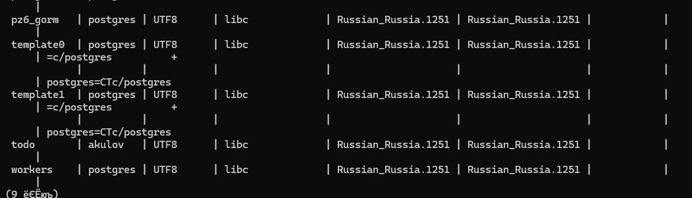
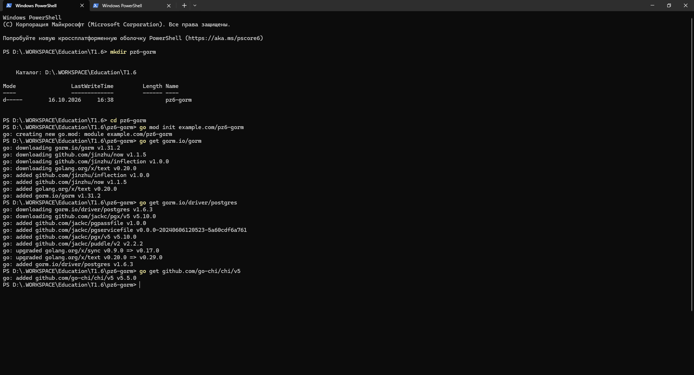
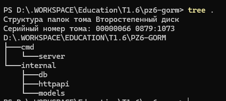
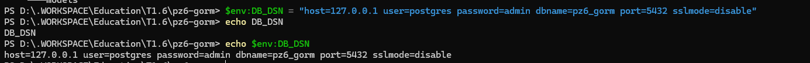
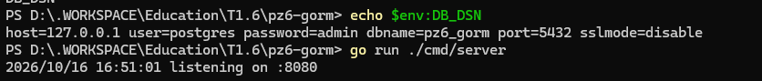
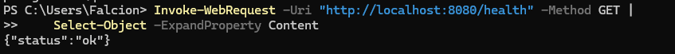
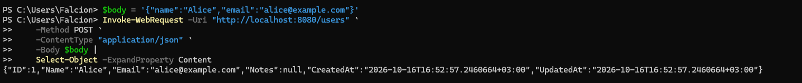
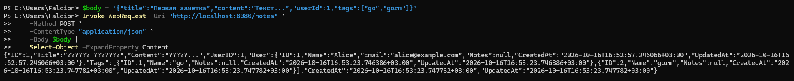
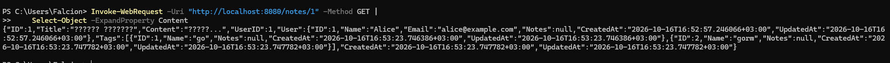
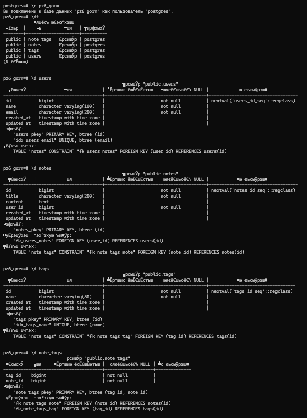

В репозитории хранится PDF версия отчёта, сделанная в редакторе Obsidian.

Исходный код находится в папке `/src/`.

# Использование ORM (GORM). Модели, миграции и связи между таблицами

## Краткое описание работы

**ORM (Object-Relational Mapping)** - это технология, которая связывает объекты программы (Go-структуры) с таблицами реляционной базы данных. 

Вместо написания SQL-запросов вручную разработчик описывает модели структурами и работает с ними как с обычными объектами, а ORM сама генерирует нужный SQL. 

В этой работе используется **GORM** - самая популярная ORM-библиотека для Go. GORM автоматически создаёт таблицы по структурам (`AutoMigrate`), поддерживает CRUD-операции, связи 1:1, 1:N, M:N и ленивую загрузку связанных данных через `Preload`. Это сильно ускоряет разработку типовых REST-приложений и защищает от SQL-инъекций за счёт параметризации запросов. 

Минус ORM - на сложных аналитических запросах она проигрывает ручному SQL, поэтому «сырой» SQL всё равно остаётся полезным.
## Шаг 1. Создание базы данных в PostgreSQL

Открываем `psql` под пользователем `postgres` и создаём БД:

```sql
CREATE DATABASE pz6_gorm;
```

Проверяем, что база создалась:

```sql
\l
```


## Шаг 2. Инициализация проекта и установка зависимостей

```powershell
mkdir pz6-gorm
cd pz6-gorm
go mod init example.com/pz6-gorm
go get gorm.io/gorm
go get gorm.io/driver/postgres
go get github.com/go-chi/chi/v5
```


## Шаг 3. Структура проекта

Создаём следующую структуру каталогов и файлов:

```
pz6-gorm/
├── cmd/
│   └── server/
│       └── main.go
├── internal/
│   ├── db/
│   │   └── postgres.go
│   ├── models/
│   │   └── models.go
│   └── httpapi/
│       ├── router.go
│       └── handlers.go
└── go.mod
```

Для этого (в Powershell) используем следующие команды:

```powershell
mkdir cmd\server
mkdir internal\db
mkdir internal\models
mkdir internal\httpapi
New-Item cmd\server\main.go
New-Item internal\db\postgres.go
New-Item internal\models\models.go
New-Item internal\httpapi\router.go
New-Item internal\httpapi\handlers.go
```


## Шаг 4. Подключение к PostgreSQL через GORM

**Файл `internal/db/postgres.go`:**

```go
package db

import (
	"log"
	"os"
	"time"

	"gorm.io/driver/postgres"
	"gorm.io/gorm"
	"gorm.io/gorm/logger"
)

func Connect() *gorm.DB {
	dsn := os.Getenv("DB_DSN")
	if dsn == "" {
		log.Fatal("DB_DSN is empty")
	}

	db, err := gorm.Open(postgres.Open(dsn), &gorm.Config{
		Logger: logger.Default.LogMode(logger.Warn),
	})
	if err != nil {
		log.Fatal("connect db:", err)
	}

	sqlDB, err := db.DB()
	if err != nil {
		log.Fatal(err)
	}
	sqlDB.SetMaxOpenConns(20)
	sqlDB.SetMaxIdleConns(10)
	sqlDB.SetConnMaxLifetime(time.Hour)

	return db
}
```

Установим переменную окружения (Powershell):

```powershell
# Либо через setx
setx DB_DSN "host=127.0.0.1 user=postgres password=admin dbname=pz6_gorm port=5432 sslmode=disable"
# Либо через объявление $env:DB_DSN
$env:DB_DSN = "host=127.0.0.1 user=postgres password=admin dbname=pz6_gorm port=5432 sslmode=disable"
```


## Шаг 5. Модели и связи

**Файл `internal/models/models.go`:**

```go
package models

import "time"

// User - автор заметок (1 пользователь → много заметок)
type User struct {
	ID        uint   `gorm:"primaryKey"`
	Name      string `gorm:"size:100;not null"`
	Email     string `gorm:"size:200;uniqueIndex;not null"`
	Notes     []Note // 1:N
	CreatedAt time.Time
	UpdatedAt time.Time
}

// Note - заметка (принадлежит пользователю, имеет много тегов)
type Note struct {
	ID        uint   `gorm:"primaryKey"`
	Title     string `gorm:"size:200;not null"`
	Content   string `gorm:"type:text"`
	UserID    uint   `gorm:"not null"`
	User      User
	Tags      []Tag `gorm:"many2many:note_tags;"` // M:N
	CreatedAt time.Time
	UpdatedAt time.Time
}

// Tag - тег (многие ко многим с заметками через note_tags)
type Tag struct {
	ID        uint   `gorm:"primaryKey"`
	Name      string `gorm:"size:50;uniqueIndex;not null"`
	Notes     []Note `gorm:"many2many:note_tags;"`
	CreatedAt time.Time
	UpdatedAt time.Time
}
```
## Шаг 6. AutoMigrate и запуск сервера

**Файл `cmd/server/main.go`:**

```go
package main

import (
	"log"
	"net/http"

	"example.com/pz6-gorm/internal/db"
	httpapi "example.com/pz6-gorm/internal/httpapi"
	"example.com/pz6-gorm/internal/models"
)

func main() {
	d := db.Connect()

	// AutoMigrate создаст таблицы users, notes, tags, note_tags
	if err := d.AutoMigrate(&models.User{}, &models.Note{}, &models.Tag{}); err != nil {
		log.Fatal("migrate:", err)
	}

	r := httpapi.BuildRouter(d)
	log.Println("listening on :8080")
	log.Fatal(http.ListenAndServe(":8080", r))
}
```
## Шаг 7. Роутер и хендлеры (минимальный REST)

**Файл `internal/httpapi/router.go`:**

```go
package httpapi

import (
	"github.com/go-chi/chi/v5"
	"gorm.io/gorm"
)

func BuildRouter(d *gorm.DB) *chi.Mux {
	r := chi.NewRouter()
	h := NewHandlers(d)

	r.Get("/health", h.Health)
	r.Post("/users", h.CreateUser)
	r.Post("/notes", h.CreateNote)
	r.Get("/notes/{id}", h.GetNoteByID)

	return r
}
```

**Файл `internal/httpapi/handlers.go`:**

```go
package httpapi

import (
	"encoding/json"
	"net/http"
	"strconv"

	"github.com/go-chi/chi/v5"
	"gorm.io/gorm"

	"example.com/pz6-gorm/internal/models"
)

type Handlers struct{ db *gorm.DB }

func NewHandlers(db *gorm.DB) *Handlers { return &Handlers{db: db} }

func (h *Handlers) Health(w http.ResponseWriter, r *http.Request) {
	writeJSON(w, http.StatusOK, map[string]string{"status": "ok"})
}

type createUserReq struct {
	Name  string `json:"name"`
	Email string `json:"email"`
}

func (h *Handlers) CreateUser(w http.ResponseWriter, r *http.Request) {
	var in createUserReq
	if err := json.NewDecoder(r.Body).Decode(&in); err != nil || in.Name == "" || in.Email == "" {
		writeErr(w, http.StatusBadRequest, "name and email are required")
		return
	}
	u := models.User{Name: in.Name, Email: in.Email}
	if err := h.db.Create(&u).Error; err != nil {
		writeErr(w, http.StatusConflict, err.Error())
		return
	}
	writeJSON(w, http.StatusCreated, u)
}

type createNoteReq struct {
	Title   string   `json:"title"`
	Content string   `json:"content"`
	UserID  uint     `json:"userId"`
	Tags    []string `json:"tags"`
}

func (h *Handlers) CreateNote(w http.ResponseWriter, r *http.Request) {
	var in createNoteReq
	if err := json.NewDecoder(r.Body).Decode(&in); err != nil || in.Title == "" || in.UserID == 0 {
		writeErr(w, http.StatusBadRequest, "title and userId are required")
		return
	}

	var tags []models.Tag
	for _, name := range in.Tags {
		if name == "" {
			continue
		}
		t := models.Tag{Name: name}
		if err := h.db.FirstOrCreate(&t, models.Tag{Name: name}).Error; err == nil {
			tags = append(tags, t)
		}
	}

	note := models.Note{
		Title:   in.Title,
		Content: in.Content,
		UserID:  in.UserID,
		Tags:    tags,
	}
	if err := h.db.Create(&note).Error; err != nil {
		writeErr(w, http.StatusBadRequest, err.Error())
		return
	}

	if err := h.db.Preload("User").Preload("Tags").First(&note, note.ID).Error; err != nil {
		writeErr(w, http.StatusInternalServerError, err.Error())
		return
	}
	writeJSON(w, http.StatusCreated, note)
}

func (h *Handlers) GetNoteByID(w http.ResponseWriter, r *http.Request) {
	idStr := chi.URLParam(r, "id")
	id, err := strconv.Atoi(idStr)
	if err != nil || id <= 0 {
		writeErr(w, http.StatusBadRequest, "bad id")
		return
	}
	var note models.Note
	if err := h.db.Preload("User").Preload("Tags").First(&note, id).Error; err != nil {
		writeErr(w, http.StatusNotFound, "note not found")
		return
	}
	writeJSON(w, http.StatusOK, note)
}

// ---------- helpers ----------

type jsonErr struct {
	Error string `json:"error"`
}

func writeJSON(w http.ResponseWriter, code int, v any) {
	w.Header().Set("Content-Type", "application/json; charset=utf-8")
	w.WriteHeader(code)
	_ = json.NewEncoder(w).Encode(v)
}

func writeErr(w http.ResponseWriter, code int, msg string) {
	writeJSON(w, code, jsonErr{Error: msg})
}
```
## Шаг 8. Запуск сервера

Запустим сервер:

```powershell
$env:DB_DSN="host=127.0.0.1 user=postgres password=admin dbname=pz6_gorm port=5432 sslmode=disable"
go run ./cmd/server
```


## Шаг 9. Проверка API

### 9.1. Проверка эндпоинта /health

```powershell
Invoke-WebRequest -Uri "http://localhost:8080/health" -Method GET |
    Select-Object -ExpandProperty Content
```


### 9.2. Создание пользователя

```powershell
$body = '{"name":"Alice","email":"alice@example.com"}'
Invoke-WebRequest -Uri "http://localhost:8080/users" `
    -Method POST `
    -ContentType "application/json" `
    -Body $body |
    Select-Object -ExpandProperty Content
```


### 9.3. Создание заметки с тегами

```powershell
$body = '{"title":"Первая заметка","content":"Текст...","userId":1,"tags":["go","gorm"]}'
Invoke-WebRequest -Uri "http://localhost:8080/notes" `
    -Method POST `
    -ContentType "application/json" `
    -Body $body |
    Select-Object -ExpandProperty Content
```


### 9.4. Получение заметки с автором и тегами

```powershell
Invoke-WebRequest -Uri "http://localhost:8080/notes/1" -Method GET |
    Select-Object -ExpandProperty Content
```

Ожидаемый ответ: та же заметка, но уже полученная через `GET` с `Preload("User").Preload("Tags")`.


## Шаг 10. Проверка схемы БД

Заново зайдём в базу данных. В `psql`:

```sql
\c pz6_gorm
\dt
\d users
\d notes
\d tags
\d note_tags
```

Должны увидеть 4 таблицы: `users`, `notes`, `tags`, `note_tags` (связка M:N). В `notes` — внешний ключ `user_id`, в `note_tags` — пара `note_id` + `tag_id`.


## Проблемы и их решения

**Проблема 1.** `DB_DSN is empty` — при запуске сервера переменная не подхватилась.  
**Решение:** после `setx` перезапустил терминал; либо задал через `$env:DB_DSN="..."` в текущей сессии.

**Проблема 2.** `duplicate key value violates unique constraint "idx_users_email"` при повторной отправке того же email.  
**Решение:** это ожидаемое поведение (в модели стоит `uniqueIndex`). Обработал возвратом HTTP 409 с текстом ошибки. Для новой записи использовал другой email.

**Проблема 3.** `relation "users" does not exist` при первом запуске без AutoMigrate.  
**Решение:** убедился, что `AutoMigrate` вызывается в `main.go` до старта сервера; проверил, что подключение идёт к БД `pz6_gorm`, а не к `postgres`.
## Ответы на контрольные вопросы

**1. Что такое ORM и зачем она нужна, если есть `database/sql`? Плюсы и минусы.**  

ORM — прослойка, которая отображает структуры языка в таблицы БД и сама генерирует SQL. Плюсы: (а) меньше шаблонного кода, быстрее разработка; (б) защита от SQL-инъекций за счёт параметризации; (в) автоматические миграции и кросс-СУБД-совместимость. Минусы: (а) на сложных запросах ORM медленнее ручного SQL; (б) для агрегаций и оконных функций всё равно приходится писать сырой SQL.

**2. Как описать связи 1:N и M:N в GORM?**  

1:N — в «родителе» поле-срез `Notes []Note`, в «ребёнке» — `UserID uint` (внешний ключ). 
M:N — срезы в обеих моделях: `Tags []Tag` в `Note` и `Notes []Note` в `Tag`, обе с тегом `gorm:"many2many:note_tags;"`. 
GORM сам создаёт промежуточную таблицу `note_tags`.

**3. Что делает `AutoMigrate`? Когда его недостаточно?**  

Создаёт таблицы по структурам, добавляет новые колонки и индексы, но **не удаляет** старые поля и **не меняет** типы. Недостаточно, когда нужно: удалить колонку, изменить тип, сделать сложную миграцию данных, откатить схему. Тогда — внешние миграции (golang-migrate, goose) или ручной SQL.

**4. Чем `Preload` отличается от `Find`/`First`?**  

`Find`/`First` возвращают только саму запись, связанные сущности остаются пустыми (GORM экономит запросы). `Preload("Notes")` выполняет отдельный запрос и подгружает связи в объект. Применять, когда нужно вернуть клиенту связанные данные (автор заметки, теги).

**5. Как обработать ошибку нарушения уникального индекса?**  

Драйвер вернёт ошибку с текстом `duplicate key value violates unique constraint ...` (PostgreSQL, код `23505`). В GORM её можно поймать по `err != nil` после `Create` и вернуть HTTP 409 Conflict. Для точной проверки — использовать `errors.Is(err, gorm.ErrDuplicatedKey)` (в GORM v2 с `TranslateError: true`) или распарсить `pgconn.PgError`.