Исходный код проекта прилагается в корневой директории. Ниже отчёт в markdown.

# Отчёт по практическому занятию №11

## Тема: Проектирование REST API (CRUD для заметок). Разработка структуры

**Дисциплина:** Стартап в информационных технологиях
**Преподаватель:** Адышкин Сергей Сергеевич
**Семестр:** 1 семестр, 2025–2026 гг.
## 1. Цель и краткое описание задания

**Цель работы:** освоить принципы проектирования REST API, научиться разрабатывать структуру backend-приложения на Go и реализовать CRUD-интерфейс для сущности «Заметка» с применением слоистой архитектуры (handler → service → repository).

**Краткое описание задания:**
Требуется спроектировать и реализовать REST API на языке Go, которое позволяет создавать, читать, обновлять и удалять заметки. Ответы должны быть в формате JSON, а HTTP-коды — корректными (200, 201, 204, 400, 404). Работа выполняется в среде Windows с использованием Go и роутера `go-chi/chi`.
## 2. Теоретические положения REST API и CRUD

**REST (Representational State Transfer)** — архитектурный стиль взаимодействия клиента и сервера по протоколу HTTP. Ключевые принципы:

- **Ресурсность** — все сущности представлены как ресурсы (`/notes`, `/notes/{id}`).
- **Стандартные HTTP-методы:** `GET`, `POST`, `PATCH/PUT`, `DELETE`.
- **Stateless** — каждый запрос самодостаточен и не требует хранения состояния на сервере.
- **Единообразие интерфейса** — одинаковая структура запросов и ответов для всех ресурсов.

**CRUD и соответствие HTTP-методам:**

| Действие | HTTP-метод | Пример запроса | Ответ |
|---|---|---|---|
| Create | POST | `/api/v1/notes` | 201 Created |
| Read | GET | `/api/v1/notes`, `/api/v1/notes/{id}` | 200 OK |
| Update | PATCH/PUT | `/api/v1/notes/{id}` | 200 OK |
| Delete | DELETE | `/api/v1/notes/{id}` | 204 No Content |

**Коды ответов:** 200 — успех, 201 — создано, 204 — выполнено без тела, 400 — некорректный запрос, 404 — не найдено, 500 — ошибка сервера.
## 3. Пошаговое выполнение работы

### Шаг 1. Подготовка окружения

Убедимся, что установлен Go (версия 1.21+), и проверим его работу в PowerShell:

```powershell
go version
```

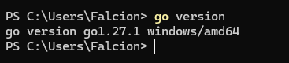
### Шаг 2. Создание проекта и инициализация модуля

```powershell
mkdir notes-api
cd notes-api
go mod init example.com/notes-api
```

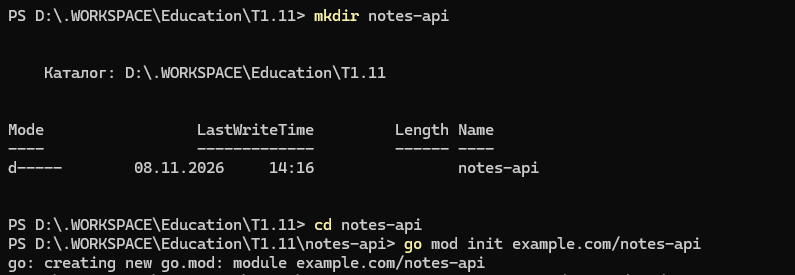
### Шаг 3. Установка роутера chi

```powershell
go get github.com/go-chi/chi/v5
```

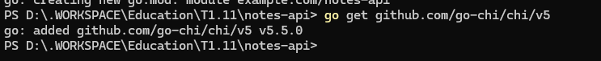
### Шаг 4. Создание структуры каталогов

В Windows можно создать все каталоги одной командой:

```powershell
mkdir cmd\api
mkdir internal\core
mkdir internal\repo
mkdir internal\http
mkdir internal\http\handlers
mkdir api
```

Итоговое дерево проекта:

```
notes-api/
├── cmd/
│   └── api/
│       └── main.go
├── internal/
│   ├── core/
│   │   └── note.go
│   ├── http/
│   │   ├── router.go
│   │   └── handlers/
│   │       └── notes.go
│   └── repo/
│       └── note_mem.go
├── api/
│   └── openapi.yaml
├── go.mod
└── go.sum
```

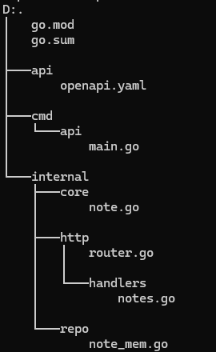
### Шаг 5. Модель данных

Создаём файл `internal\core\note.go`:

```go
package core

import "time"

type Note struct {
	ID        int64      `json:"id"`
	Title     string     `json:"title"`
	Content   string     `json:"content"`
	CreatedAt time.Time  `json:"createdAt"`
	UpdatedAt *time.Time `json:"updatedAt,omitempty"`
}
```
### Шаг 6. In-memory репозиторий

Создаём файл `internal\repo\note_mem.go`:

```go
package repo

import (
	"errors"
	"sort"
	"sync"
	"time"

	"example.com/notes-api/internal/core"
)

var ErrNotFound = errors.New("note not found")

type NoteRepoMem struct {
	mu    sync.Mutex
	notes map[int64]*core.Note
	next  int64
}

func NewNoteRepoMem() *NoteRepoMem {
	return &NoteRepoMem{notes: make(map[int64]*core.Note)}
}

func (r *NoteRepoMem) Create(n core.Note) (int64, error) {
	r.mu.Lock()
	defer r.mu.Unlock()

	r.next++
	n.ID = r.next
	n.CreatedAt = time.Now()
	r.notes[n.ID] = &n
	return n.ID, nil
}

func (r *NoteRepoMem) GetByID(id int64) (*core.Note, error) {
	r.mu.Lock()
	defer r.mu.Unlock()

	n, ok := r.notes[id]
	if !ok {
		return nil, ErrNotFound
	}
	return n, nil
}

func (r *NoteRepoMem) List() []*core.Note {
	r.mu.Lock()
	defer r.mu.Unlock()

	res := make([]*core.Note, 0, len(r.notes))
	for _, n := range r.notes {
		res = append(res, n)
	}
	sort.Slice(res, func(i, j int) bool { return res[i].ID < res[j].ID })
	return res
}

func (r *NoteRepoMem) Update(id int64, title, content *string) (*core.Note, error) {
	r.mu.Lock()
	defer r.mu.Unlock()

	n, ok := r.notes[id]
	if !ok {
		return nil, ErrNotFound
	}
	if title != nil {
		n.Title = *title
	}
	if content != nil {
		n.Content = *content
	}
	now := time.Now()
	n.UpdatedAt = &now
	return n, nil
}

func (r *NoteRepoMem) Delete(id int64) error {
	r.mu.Lock()
	defer r.mu.Unlock()

	if _, ok := r.notes[id]; !ok {
		return ErrNotFound
	}
	delete(r.notes, id)
	return nil
}
```
### Шаг 7. HTTP-обработчики (CRUD)

Создаём файл `internal\http\handlers\notes.go`:

```go
package handlers

import (
	"encoding/json"
	"errors"
	"net/http"
	"strconv"

	"github.com/go-chi/chi/v5"

	"example.com/notes-api/internal/core"
	"example.com/notes-api/internal/repo"
)

type Handler struct {
	Repo *repo.NoteRepoMem
}

func (h *Handler) CreateNote(w http.ResponseWriter, r *http.Request) {
	var n core.Note
	if err := json.NewDecoder(r.Body).Decode(&n); err != nil {
		http.Error(w, "Invalid input", http.StatusBadRequest)
		return
	}
	if n.Title == "" {
		http.Error(w, "Title is required", http.StatusBadRequest)
		return
	}
	id, _ := h.Repo.Create(n)
	n.ID = id

	w.Header().Set("Content-Type", "application/json")
	w.WriteHeader(http.StatusCreated)
	json.NewEncoder(w).Encode(n)
}

func (h *Handler) ListNotes(w http.ResponseWriter, r *http.Request) {
	notes := h.Repo.List()
	w.Header().Set("Content-Type", "application/json")
	json.NewEncoder(w).Encode(notes)
}

func (h *Handler) GetNote(w http.ResponseWriter, r *http.Request) {
	id, err := parseID(r)
	if err != nil {
		http.Error(w, "Invalid id", http.StatusBadRequest)
		return
	}

	n, err := h.Repo.GetByID(id)
	if err != nil {
		http.Error(w, "Note not found", http.StatusNotFound)
		return
	}

	w.Header().Set("Content-Type", "application/json")
	json.NewEncoder(w).Encode(n)
}

func (h *Handler) UpdateNote(w http.ResponseWriter, r *http.Request) {
	id, err := parseID(r)
	if err != nil {
		http.Error(w, "Invalid id", http.StatusBadRequest)
		return
	}

	var req struct {
		Title   *string `json:"title"`
		Content *string `json:"content"`
	}
	if err := json.NewDecoder(r.Body).Decode(&req); err != nil {
		http.Error(w, "Invalid input", http.StatusBadRequest)
		return
	}

	n, err := h.Repo.Update(id, req.Title, req.Content)
	if errors.Is(err, repo.ErrNotFound) {
		http.Error(w, "Note not found", http.StatusNotFound)
		return
	}

	w.Header().Set("Content-Type", "application/json")
	json.NewEncoder(w).Encode(n)
}

func (h *Handler) DeleteNote(w http.ResponseWriter, r *http.Request) {
	id, err := parseID(r)
	if err != nil {
		http.Error(w, "Invalid id", http.StatusBadRequest)
		return
	}

	if err := h.Repo.Delete(id); errors.Is(err, repo.ErrNotFound) {
		http.Error(w, "Note not found", http.StatusNotFound)
		return
	}

	w.WriteHeader(http.StatusNoContent)
}

func parseID(r *http.Request) (int64, error) {
	return strconv.ParseInt(chi.URLParam(r, "id"), 10, 64)
}
```
### Шаг 8. Маршрутизация

Создаём файл `internal\http\router.go`:

```go
package httpx

import (
	"github.com/go-chi/chi/v5"

	"example.com/notes-api/internal/http/handlers"
)

func NewRouter(h *handlers.Handler) *chi.Mux {
	r := chi.NewRouter()

	r.Post("/api/v1/notes", h.CreateNote)
	r.Get("/api/v1/notes", h.ListNotes)
	r.Get("/api/v1/notes/{id}", h.GetNote)
	r.Patch("/api/v1/notes/{id}", h.UpdateNote)
	r.Delete("/api/v1/notes/{id}", h.DeleteNote)

	return r
}
```
### Шаг 9. Точка входа

Создаём файл `cmd\api\main.go`:

```go
package main

import (
	"log"
	"net/http"

	httpx "example.com/notes-api/internal/http"
	"example.com/notes-api/internal/http/handlers"
	"example.com/notes-api/internal/repo"
)

func main() {
	noteRepo := repo.NewNoteRepoMem()
	h := &handlers.Handler{Repo: noteRepo}
	r := httpx.NewRouter(h)

	log.Println("Server started at :8080")
	if err := http.ListenAndServe(":8080", r); err != nil {
		log.Fatal(err)
	}
}
```
### Шаг 10. Запуск сервера

```powershell
go mod tidy
go run ./cmd/api
```

В консоли появится сообщение `Server started at :8080`.

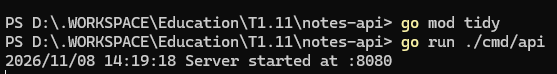
### Шаг 11. Проверка CRUD-методов

> В PowerShell алиас `curl` указывает на `Invoke-WebRequest`, поэтому используем `curl.exe`.

```powershell
function ConvertTo-Utf8Body($obj) {
    [Text.Encoding]::UTF8.GetBytes(($obj | ConvertTo-Json -Compress))
}
# зададим функцию для конвертации кириллицы в запросы
```

**Create — создание заметки (POST):**

```powershell
$new = @{ title = "Первая заметка"; content = "Это тест" } | ConvertTo-Json -Compress
Invoke-RestMethod -Method Post `
  -Uri http://localhost:8080/api/v1/notes `
  -ContentType 'application/json; charset=utf-8' `
  -Body ([Text.Encoding]::UTF8.GetBytes($new))
```

Ожидаем `201 Created` и JSON с `id = 1`.

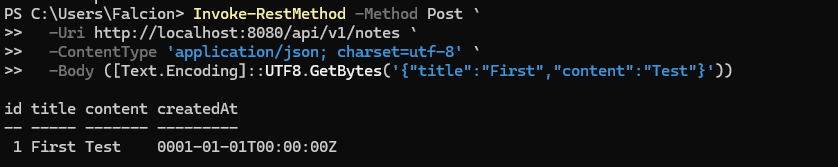

**Read (список) — получение всех заметок (GET):**

```powershell
curl.exe http://localhost:8080/api/v1/notes
```

Ожидаем `200 OK` и массив заметок.

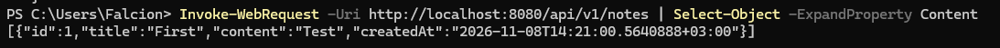

**Read (по id) — получение одной заметки (GET):**

```powershell
Invoke-RestMethod -Uri http://localhost:8080/api/v1/notes/1
```

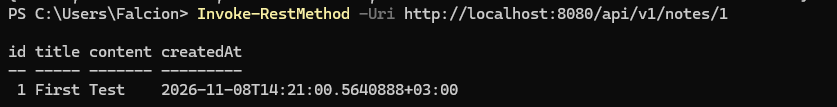

**Update — обновление заметки (PATCH):**

```powershell
$json = '{"content":"Обновлённый текст"}'
$bytes = [Text.Encoding]::UTF8.GetBytes($json)

$r = Invoke-WebRequest -Method Patch `
  -Uri http://localhost:8080/api/v1/notes/1 `
  -ContentType 'application/json; charset=utf-8' `
  -Body $bytes

$r.Content
```

Ожидаем `200 OK` и обновлённое поле `content` + `updatedAt`.

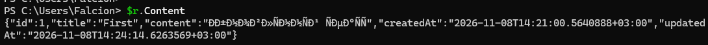

**Delete — удаление заметки (DELETE):**

```powershell
$r = Invoke-WebRequest -Method Delete -Uri http://localhost:8080/api/v1/notes/1
"StatusCode: $($r.StatusCode)"
```

Ожидаем `204 No Content`.

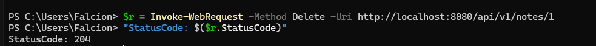

**Проверка обработки ошибок — запрос несуществующей заметки (404):**

```powershell
try { Invoke-WebRequest -Uri http://localhost:8080/api/v1/notes/999 }
catch { "StatusCode: $([int]$_.Exception.Response.StatusCode)"; $_.ErrorDetails.Message }
```

Ожидаем `404 Not Found`.

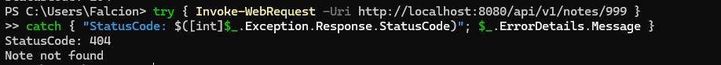
## 4. Выводы

В ходе работы были освоены принципы проектирования REST API и реализован полноценный CRUD-интерфейс для сущности «Заметка» на языке Go:

1. **Спроектирован REST API** с версионированием `/api/v1/` и корректным сопоставлением CRUD-операций HTTP-методам (POST → 201, GET → 200, PATCH → 200, DELETE → 204).
2. **Реализована слоистая архитектура**: слой `handlers` отвечает за HTTP, `repo` — за хранение данных (пока в памяти), `core` — за модель. Это упрощает тестирование и последующую замену in-memory репозитория на БД.
3. **Обеспечена потокобезопасность** in-memory хранилища за счёт `sync.Mutex`.
4. **Обработаны ошибки**: некорректный JSON или `id` → 400, отсутствующая заметка → 404.
5. **Проверено поведение API** с помощью `curl.exe` (и/или Postman): все методы возвращают ожидаемые коды и JSON.

Полученная структура является готовой основой для следующих занятий: интеграции с PostgreSQL и добавления JWT-аутентификации.
## 5. Ответы на контрольные вопросы

1. **REST** — Representational State Transfer; архитектурный стиль, при котором всё представлено ресурсами, а взаимодействие идёт по HTTP стандартными методами, без хранения состояния на сервере.
2. **CRUD ↔ HTTP:** Create → POST, Read → GET, Update → PUT/PATCH, Delete → DELETE.
3. **Слоистая архитектура** разделяет ответственность: handler — HTTP, service — бизнес-логика, repository — доступ к данным. Это упрощает тестирование, замену БД и повторное использование кода.
4. **Stateless** — каждый запрос содержит всю информацию для его обработки; сервер не хранит сессию клиента между запросами (состояние, например, передаётся в токене).
5. **Стандартные коды** обеспечивают единое понимание результата клиентами и промежуточными сервисами (прокси, балансировщики), упрощают отладку и обработку ошибок.
6. **Аутентификация** добавляется middleware: клиент передаёт JWT в заголовке `Authorization: Bearer <token>`, middleware проверяет подпись и кладёт пользователя в контекст запроса.
7. **Версионирование `/api/v1/`** позволяет выпускать несовместимые изменения, не ломая существующих клиентов; старые версии можно поддерживать параллельно.